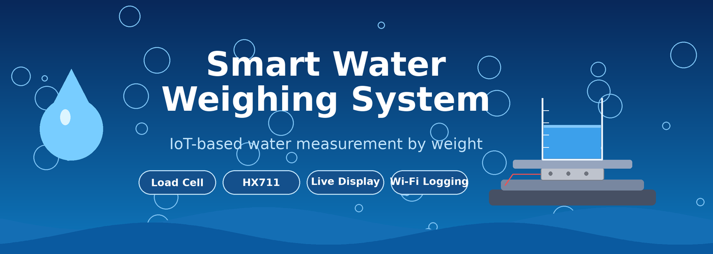
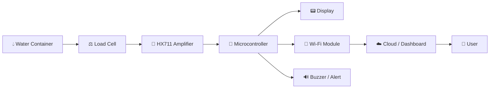
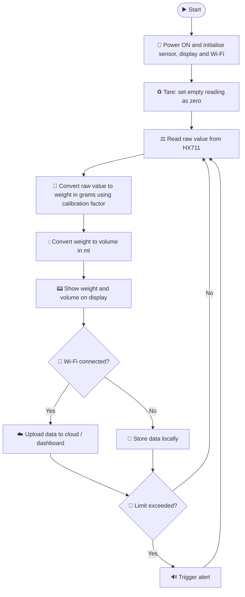
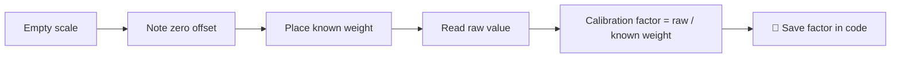
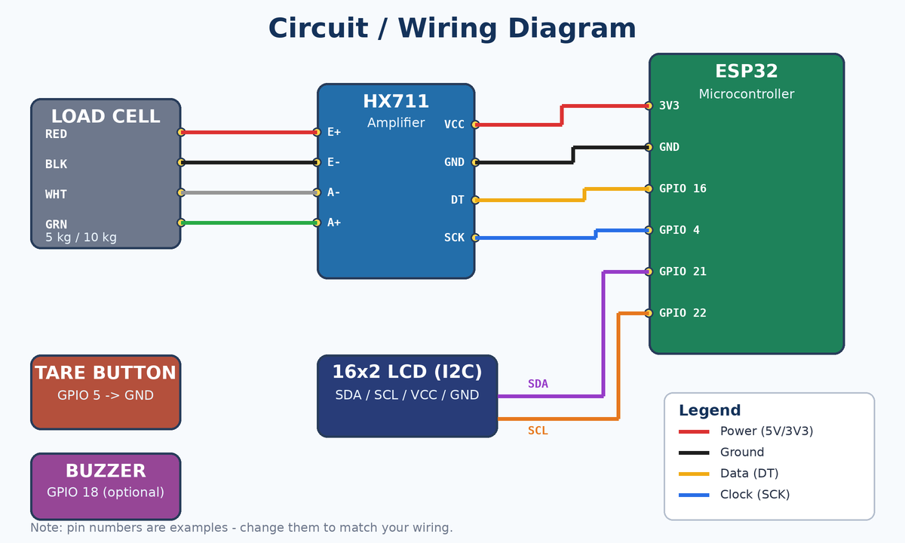
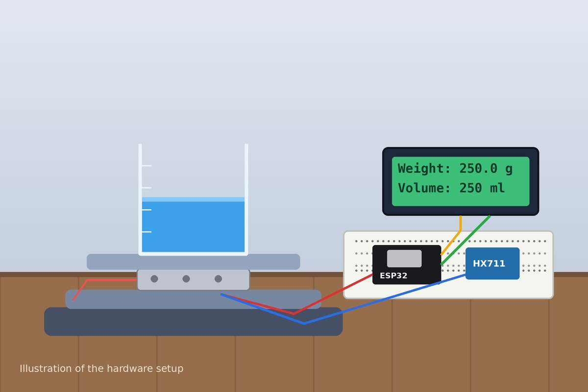
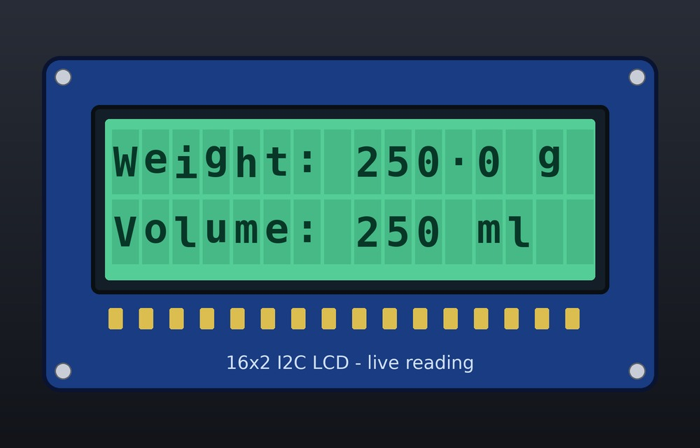
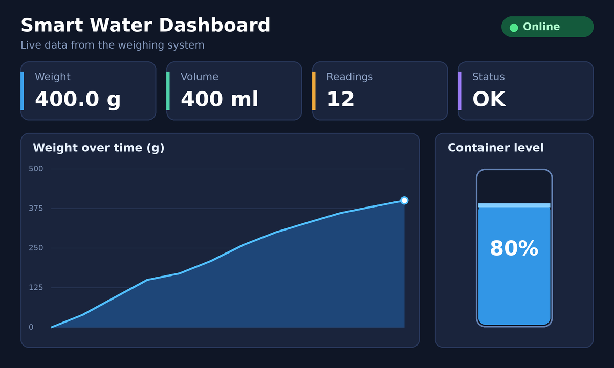
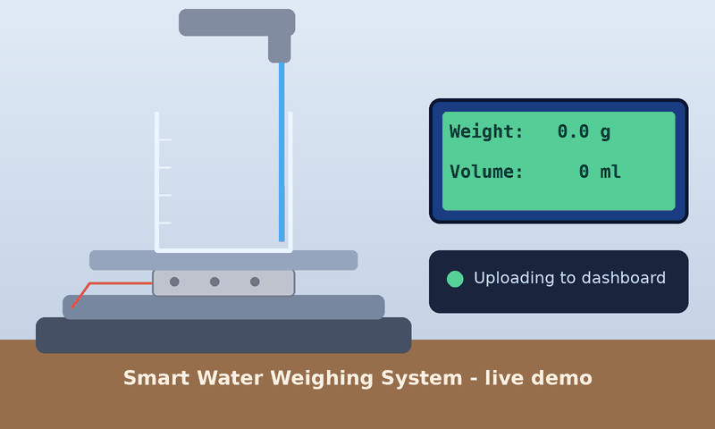

<div align="center">

# 💧⚖️ Smart Water Weighing System

**An IoT-based system that measures water by weight, shows it live, and logs the data automatically.**


<!-- 📸 EDIT: put your best project photo at docs/images/banner.png -->


</div>

---

## 📑 Table of Contents

- [📖 About the Project](#-about-the-project)
- [✨ Features](#-features)
- [🧰 Hardware Required](#-hardware-required)
- [💻 Software and Tools](#-software-and-tools)
- [🏗️ System Architecture](#️-system-architecture)
- [🔄 Working Flowchart](#-working-flowchart)
- [🔌 Circuit and Connections](#-circuit-and-connections)
- [📸 Project Images](#-project-images)
- [🚀 Getting Started](#-getting-started)
- [⚖️ Calibration](#️-calibration)
- [🧪 Usage](#-usage)
- [📁 Folder Structure](#-folder-structure)
- [🔮 Future Scope](#-future-scope)
- [🙌 Credits](#-credits)

---

## 📖 About the Project

Measuring water by hand is slow and often inaccurate. The **Smart Water Weighing System** uses a **load cell** to weigh water accurately. A microcontroller converts the reading into **weight and volume** (1 g of water is about 1 ml) and shows it live on a display. The data can also be sent to a dashboard or cloud for monitoring and logging. 🌐

> 💡 **Why it matters:** accurate measurement helps with water conservation, dispensing control and record keeping.

---

## ✨ Features

| | Feature | Description |
|---|---------|-------------|
| ⚖️ | **Accurate weighing** | Load cell and HX711 amplifier give precise readings |
| 💧 | **Weight to volume** | Converts grams into millilitres automatically |
| 📟 | **Live display** | Shows the reading in real time (LCD / OLED / Serial) |
| ♻️ | **Tare function** | Zero the scale with an empty container |
| 📡 | **Wireless data** | Sends readings over Wi-Fi to a dashboard or cloud |
| 🗂️ | **Data logging** | Stores readings for later analysis |
| 🔔 | **Threshold alert** | Optional buzzer or notification at a set limit |

---

## 🧰 Hardware Required

<!-- ✏️ EDIT: change this list to match the parts you actually used -->

| # | Component | Purpose |
|---|-----------|---------|
| 1 | 🧠 ESP32 / ESP8266 / Arduino | Main controller |
| 2 | ⚖️ Load cell (e.g. 5 kg / 10 kg) | Senses weight |
| 3 | 🔧 HX711 amplifier module | Reads the load cell signal |
| 4 | 📟 16x2 LCD (I2C) / OLED | Displays weight and volume |
| 5 | 🔘 Push button | Tare / reset |
| 6 | 🔊 Buzzer (optional) | Alert |
| 7 | 🔋 Power supply (5 V) | Powers the circuit |
| 8 | 🔌 Jumper wires and breadboard | Connections |

---

## 💻 Software and Tools

- 🛠️ **Arduino IDE** (or PlatformIO)
- 📚 **HX711 library** for the load cell amplifier
- 📚 **LiquidCrystal_I2C** (if using an LCD)
- ☁️ **Dashboard or cloud** (Blynk / ThingSpeak / custom web dashboard)

---

## 🏗️ System Architecture



---

## 🔄 Working Flowchart



### 🔁 Calibration Flow



---

## 🔌 Circuit and Connections

<!-- ✏️ EDIT: change pin numbers to match your wiring -->

| HX711 Pin | Connects To |
|-----------|-------------|
| VCC | 5 V / 3.3 V |
| GND | GND |
| DT (DOUT) | GPIO __ |
| SCK | GPIO __ |

| Load Cell Wire | HX711 Terminal |
|----------------|----------------|
| 🔴 Red | E+ |
| ⚫ Black | E- |
| ⚪ White | A- |
| 🟢 Green | A+ |

<!-- 📸 EDIT: add your circuit diagram at docs/images/circuit.png -->


---

## 📸 Project Images

<!-- 📸 EDIT: save your photos in docs/images/ with these names (or change the names below) -->

| 🔧 Hardware Setup | 📟 Display Output |
|:---:|:---:|
|  |  |

| 📊 Dashboard | 🎥 Working Demo |
|:---:|:---:|
|  |  |

---

## 🚀 Getting Started

### 1️⃣ Clone the repository
```bash
git clone https://github.com/aasthapandya04/smart_water_weighing_system.git
cd smart_water_weighing_system
```

### 2️⃣ Install the required libraries
In Arduino IDE go to **Sketch → Include Library → Manage Libraries** and install:
- `HX711`
- `LiquidCrystal_I2C` (if you use an LCD)
- Wi-Fi / cloud library for your board

### 3️⃣ Configure the code
Open the `.ino` file and update:
```cpp
const char* ssid     = "YOUR_WIFI_NAME";
const char* password = "YOUR_WIFI_PASSWORD";
```

### 4️⃣ Upload
Select your **board** and **COM port**, then click **Upload** ⬆️.

---

## ⚖️ Calibration

1. Remove everything from the scale and power it on (tare happens automatically) ♻️
2. Place an object of **known weight** (e.g. 500 g) on the scale
3. Read the raw value from the Serial Monitor
4. Compute: `calibration_factor = raw_value / known_weight`
5. Set this value in the code and re-upload ✅

---

## 🧪 Usage

1. 🔌 Power on the device
2. 🥛 Place an empty container and press **Tare**
3. 💧 Pour water into the container
4. 📟 Read the weight (g) and volume (ml) on the display
5. 📱 View the data on the dashboard (if connected)

---

## 📁 Folder Structure

<!-- ✏️ EDIT: match this to your real files -->

```
smart_water_weighing_system/
├── 📂 code/            # Arduino / firmware source (.ino)
├── 📂 docs/
│   └── 📂 images/      # Photos, circuit diagram, screenshots
├── 📂 report/          # Project report / PPT (if any)
├── 📄 README.md
└── 📄 LICENSE
```

---

## 🔮 Future Scope

- 📲 Mobile app with real-time graphs
- 🤖 Auto-shutoff valve when the target amount is reached
- 🧠 Leak and wastage detection using data analytics
- 🔋 Battery and solar powered version
- 🗣️ Voice or multi-language display

---

## 🙌 Credits

- 👨‍💻 Original project by **[rishirena](https://github.com/rishirena/smart-water-weighing-system)**
- 📚 Cloned and maintained by **[aasthapandya04](https://github.com/aasthapandya04)**

---

<div align="center">

⭐ **If you found this useful, give the repo a star!** ⭐

Made with 💙 and a lot of 💧

</div>
